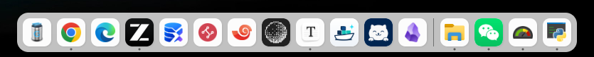

# DockBar

**Windows 桌面环境重塑** — Dock 任务栏 · 桌面小组件 · 主题系统 · 图标包，一个安装包全带走

Windows 10 · Windows 11 · x64 · ARM64

[](LICENSE)
[](https://github.com/WuYiLingOps/DockBar/releases)
[](https://tauri.app)
[](https://rustup.rs)
[](https://svelte.dev)

**开源地址**：[GitHub](https://github.com/WuYiLingOps/DockBar)

Windows 的任务栏几十年没怎么变过：图标固定在左下角、样式跟着系统走，想换个形态只能装一堆修改器互相打架。

DockBar 用可换肤的小组件替换系统任务栏——macOS 式 Dock 或传统任务栏两种形态随你切，悬停图标弹簧放大、多显示器独立配置、
桌面小组件、CSS 主题、图标包，都是设置里的一道开关或一个资源文件夹。Tauri 2 多窗口 + Rust 后端直连 Win32/WinRT，
不修改注册表、不替换 explorer，退出后系统原样还在。

[项目预览](#项目预览) · [它能做什么](#它能做什么) · [怎么工作](#怎么工作) · [技术栈](#技术栈) · [快速开始](#快速开始) ·
[构建与安装](#构建与安装) · [资源开发](#资源开发) · [项目结构](#项目结构)

---

## 项目预览



## 它能做什么

- **Dock 任务栏** — 全宽任务栏与 macOS 式 Dock
  两种模式；位置、内边距、图标间距逐项可调；自动隐藏，窗口请求关注时自动弹出；同类窗口归组或拆分、实例计数徽标；一键导入系统任务栏已固定的项目
- **悬停体验** — 弹簧物理驱动的图标放大动画（强度可调、可关），邻居图标按距离衰减让位；悬停显示应用名提示
- **多显示器** — 每台显示器一份独立配置，热插拔即时重建对应 Dock 实例
- **桌面小组件** — 内置右键菜单、图标编辑器、应用固定选择器等；第三方小组件是任意技术栈写的 SPA，经 `dockbar-cli`
  热加载进正在运行的系统，支持多实例
- **主题与图标包** — CSS/SCSS 主题按组件 ID 定向换肤，支持用户可配置的 CSS
  变量（设置里呈现为表单）；图标包整体替换应用图标
- **设置中心** — 通用、按显示器、快捷键（改键带冲突检测）、开发者工具；设置持久化并热应用，改完即生效
- **国际化** — 73 种语言内建（含简体 / 繁体中文），资源文案可机翻补全

### 它不是什么

__它不是__窗口管理器——不做平铺布局与虚拟桌面（上游规划，尚未实现）；__也不是__主题补丁——不改系统文件，DockBar
退出即还原； __更不是__封闭生态——资源就是本地文件夹，本地加载不联网。

## 怎么工作

```
Svelte 5 / Preact 小组件窗口 ◄── Tauri IPC / Channel ──► Rust 后端（tokio）
                                                            │
                                    windows-rs（Win32/WinRT/COM）
                                                            │
                     ┌──────────────────────┬───────────────┴─────────────┐
                     ▼                      ▼                               ▼
              Shell 任务栏注册          显示器管理                      应用/开始菜单索引
           （SHAppBarMessage，     （热插拔触发小组件            （解析与固定 Dock 条目、
             退出即还原）            实例重建）                      开始菜单搜索定位）
```

- **小组件怎么跑** — 每个实例是独立 Tauri WebView 窗口，`WidgetManager` 统一部署回收；系统交互全部在 Rust 后端
- **资源怎么加载** — 资源 = 文件夹 + `metadata.yml`（YAML 扩展支持 `!include` 内嵌 SCSS）；启动扫描，运行中可热加载卸载
- **怎么打包** — NSIS 安装包内嵌 WebView2 Fixed Version Runtime，目标机器无需在线装运行时；完整性基于构建期 SHA256SUMS

## 技术栈

| 层       | 选型                                               | 说明                                            |
| -------- | -------------------------------------------------- | ----------------------------------------------- |
| 桌面框架 | Tauri 2                                            | 系统原生 WebView2，多窗口小组件架构             |
| 后端     | Rust（nightly，`rust-toolchain.toml` 锁定）+ tokio | Win32/WinRT/COM 直连经 `windows-rs`             |
| 前端     | Svelte 5（小组件）+ Preact（设置面板）             | esbuild 构建，`@dockbar/lib` 共享库             |
| 共享库   | `libs/core`（Deno）                                | Rust ↔ TS 类型绑定（ts-rs 生成）、命令/事件封装 |
| 工具链   | Deno（fmt / lint / check）+ Lefthook + Commitlint  | 提交即门禁：格式化、clippy `-D warnings`        |
| 打包     | NSIS + WebView2 Fixed Runtime                      | GitHub Actions tag 触发，x64 / ARM64 双架构     |

## 快速开始

**前置要求**：Windows 10 / 11；[Rust](https://rustup.rs)（工具链自动安装）；Node.js 20+；Deno 2.x。

```bash
git clone https://github.com/WuYiLingOps/DockBar.git
cd DockBar
npm install        # preinstall 钩子会先构建 libs/core 绑定
npm run dev        # 构建 Rust 后端并启动 Tauri dev
```

**测试与检查**：

```bash
cargo check --locked            # Rust 类型检查（迭代期用这个，别用 --release）
cargo clippy --locked --all-targets -- -D warnings
cargo test --locked             # Rust 测试
npm run type-check              # tsc + svelte-check + deno check
deno fmt --check && deno lint   # 前端格式与 lint
```

提交流程经 Lefthook 强制（pre-commit 格式化与 lint，commit-msg 走
[Conventional Commits](https://www.conventionalcommits.org/)）。

## 构建与安装

### 方式一：下载安装包（推荐）

从 [Releases](https://github.com/WuYiLingOps/DockBar/releases) 下载 `DockBar_<版本>_x64-setup.exe`（主流设备）或
`DockBar_<版本>_arm64-setup.exe`（ARM 设备）。安装包内嵌 WebView2 Fixed Version Runtime，目标机器无需在线安装运行时。
未配置代码签名，首次运行可能出现 SmartScreen 提示（「更多信息 → 仍要运行」）。

### 方式二：本地构建

Windows 使用 `management.ps1` 一键脚本（被执行策略拦截时加 `powershell -ExecutionPolicy Bypass -File` 前缀）：

```powershell
.\management.ps1 build           # 打包 NSIS 安装包
.\management.ps1 build 1.0.1     # 同步版本号后打包
.\management.ps1 version 1.0.1   # 只同步版本号，不构建
.\management.ps1 install         # 静默安装
.\management.ps1 uninstall       # 静默卸载
.\management.ps1 dev             # 开发模式（同 npm run dev）
.\management.ps1 clean           # 清理构建产物
```

发布版由 GitHub Actions 构建：push `v*.*.*` tag 触发，CI 门禁 → 双架构编译 → NSIS 打包 → 上传 Release。

## 资源开发

一切可定制内容都是资源（resource）：一个文件夹 + 一份 `metadata.yml`，资源 ID 形如 `@用户名/资源名`。三种类型：
**小组件**（任意框架的 SPA）、**主题**（CSS/SCSS + 可配置变量）、**图标包**。

```bash
dockbar-cli resource load theme ./my-theme     # 热加载进正在运行的 DockBar
dockbar-cli resource unload theme ./my-theme   # 卸载
dockbar-cli resource bundle theme ./my-theme   # 产出 .yaml 分发包
```

| 文档                                             | 内容                                              |
| ------------------------------------------------ | ------------------------------------------------- |
| [资源指南](documentation/resource-guidelines.md) | 资源 ID、元数据、`!include`/`!extend`、加载与分发 |
| [小组件指南](documentation/widget-guidelines.md) | 窗口预设、多实例、用户可配置设置                  |
| [小组件 JS API](documentation/widget-js-api.md)  | `init`/`ready` 生命周期、`invoke`/`subscribe`     |
| [主题指南](documentation/theme-guidelines.md)    | 定向换肤、CSS 变量、性能模式约束                  |
| [设计系统](documentation/design-system.md)       | 内置 UI 的设计契约：扁平设计、设计令牌            |

## 项目结构

```
libs/
├── core/                # 共享库：Rust 核心 + TS 绑定（ts-rs 生成）、命令/事件封装、设置模型
├── dockbar-ipc/         # 进程间通信类型（CLI 与主进程共享）
├── dockbar-macros/      # Rust 过程宏（event_manager!、命令声明）
├── utils/               # Rust 工具 crate
└── ui/                  # 共享前端原语（图标、拖拽、Svelte 组件）
src/
├── background/          # Rust 后端：系统模块（apps/monitors/power/start）、Win32 封装（windows_api/）、
│                        # 小组件运行时（widgets/）、设置模型（state/）、资源加载（resources/）
├── ui/
│   ├── svelte/          # Svelte 5 小组件：dock、context-menu、icon-editor、app-picker 等
│   ├── react/           # Preact 应用：settings（设置中心）、dialog
│   └── vanilla/         # 入口与完整性校验
├── static/              # 内置资源：图标、应用分类模板
└── templates/           # NSIS 安装器模板与钩子（SHA256SUMS 校验）
scripts/                 # 构建（esbuild 多目标）、版本同步、翻译
documentation/           # 开发与资源作者文档
```

## 版本与发布

版本号唯一来源是 `package.json`，`./management.ps1 version <x.y.z>` 一键同步到全部清单；打 `v*.*.*` tag
自动触发构建发布， 历次版本的变更与安装包见 [Releases](https://github.com/WuYiLingOps/DockBar/releases) 页。

## 许可证

[MIT](LICENSE)

## 反馈

遇到问题或有新想法，欢迎提 [GitHub Issue](https://github.com/WuYiLingOps/DockBar/issues)；如果 DockBar 帮到了你，
欢迎点个 ⭐ Star 支持开发。
